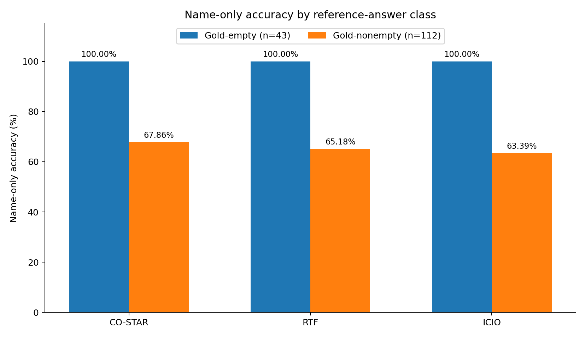

# Task 3 — Additional metric for evaluating Text-to-SQL

## Proposed metric: Name-only Execution Accuracy (NEA)

The official evaluator compares the complete multiset of `(restaurant_id, restaurant_name)` tuples produced by an SQL query to the gold reference rows. We propose an **additional**, execution-based metric that compares the multiset of restaurant **names** only. The SQL is still executed on the supplied SQLite database; it is not compared as raw text.

For question `i`, let `P_i` be the executed prediction result rows and `G_i` be the gold result rows. Define `M(R)` to be the multiset of the second field (`NAME`) from a two-column result `R`:

```
NEA = (1/N) * Σ_{i=1..N} 1[M(P_i) = M(G_i)],    N = 155
```

Results must contain **exactly two columns**, and duplicates are counted (e.g. `['A','A']` is different from `['A']`). Row ordering is ignored. An invalid, missing, or non-executable SQL statement gets 0. Empty predicted and reference rowsets match. The implemented evaluation uses `collections.Counter` and the original repository's SQLite loader; it does **not** modify reference labels.

## Why a new metric is warranted

The supplied dataset contains inconsistent identifiers: the integrity audit found **3/13,235** gold `(ID, NAME)` pairs in the real database, while **13,235/13,235** corresponding names occur. A correct query may therefore retrieve the intended restaurant name under a different actual ID from the one in the gold labels. **NEA measures whether the queried names agree**, offering a useful diagnostic of retrieval when identifier alignment is broken.

**NEA complements, not replaces, official exact execution accuracy.** It is weaker when multiple restaurants share the same name, when ID matters, or when an incorrect query happens to yield the same name multiset. It is not a universal replacement for entity-aware database evaluation.

## Supplementary class-balanced metric (BNEA)

There are 43 gold-empty and 112 gold-nonempty questions. Overall accuracy can be inflated by predicting empty results for cases where the gold is empty. Define:

```
BNEA = 0.5 * (NEA_empty + NEA_nonempty)
```

Both class-specific rates are reported for clarity.

## Final calculated values

| Metric | CO-STAR | RTF | ICIO |
|---|---:|---:|---:|
| Gold-empty name matches | 43/43 | 43/43 | 43/43 |
| Gold-nonempty name matches | **76/112** | 73/112 | 71/112 |
| Gold-nonempty name accuracy | **67.86%** | 65.18% | 63.39% |
| Total NEA matches | **119/155** | 116/155 | 114/155 |
| Name-only accuracy (NEA) | **76.77%** | 74.84% | 73.55% |
| Balanced NEA (BNEA) | **83.93%** | 82.59% | 81.70% |
| Official exact accuracy | 27.74% | 27.74% | 27.74% |



In the gold-nonempty subset, CO-STAR exceeds RTF by **2.68 percentage points** (three more correct questions of 112) and ICIO by **4.46 percentage points** (five more). The observed name-only advantage is modest, and its statistical significance is addressed in Task 4.

## Implementation

The reproducible source code is **`week03_starter/analyze_name_accuracy.py`**. It reads `results/predictions_co_star.csv`, `predictions_rtf.csv`, and `predictions_icio.csv`, obtains expected rows from `restaurants_dataset.csv`, executes each query via the official database loader, and compares `Counter` multisets of name fields. It also calculates class-balanced accuracy and paired significance tests and writes detailed outputs under `analysis_name/`.

To rerun it inside `Week_03_Prompting/week03_starter`:

```powershell
.\.venv\Scripts\python.exe analyze_name_accuracy.py --results-dir results
```

The implementation is kept separate from the official evaluator and does not leak expected IDs or gold result rows into the prompts. If data owner supplies repaired label IDs, the standard full-row exact metric should be recalculated and prioritized. Because the names can be repeated in real data, a future improvement would validate a canonical restaurant identity mapping independently of benchmark answer labels.

**Evidence note:** Numbers above were transcribed from the final output of the user's scripts; review `analysis_name/metrics.csv` and `analysis_name/question_level.csv` before submitting.
