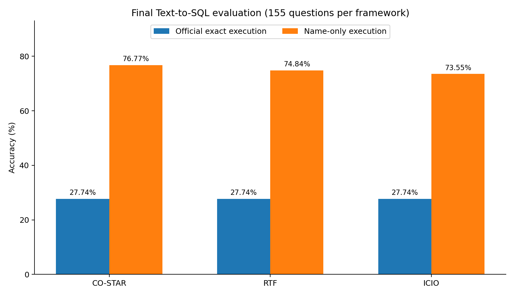
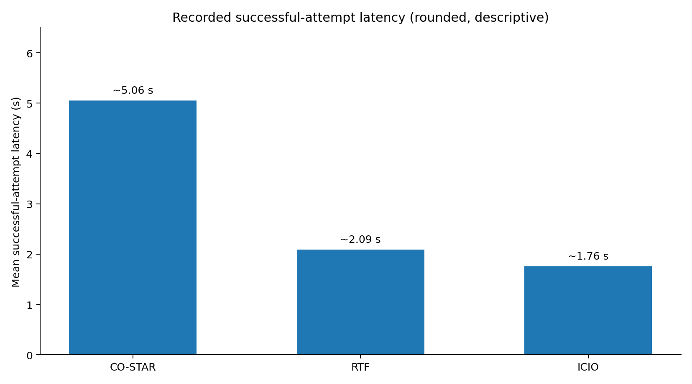

# Task 4 — Detailed prompt comparison, statistical significance and interpretation

## Design

All **155 questions** were answered under three preselected structured prompting frameworks (CO-STAR, RTF, ICIO) using **Gemini 3.1 Flash-Lite** with the same schema, SQL constraints and three shared synthetic few-shot examples. Each question-framework pair used a fresh single-turn request. There were **465 successful API calls** in the final result set, including requests recovered via retry. The prompts were processed in framework blocks, not randomized order. The coding workflow was shared across conditions.

## Final metric values

| Metric | CO-STAR | RTF | ICIO |
|---|---:|---:|---:|
| Valid executable SQL | 155/155 | 155/155 | 155/155 |
| Official correct (total) | 43/155 | 43/155 | 43/155 |
| Official accuracy | 27.74% | 27.74% | 27.74% |
| Official correct, gold empty | 43/43 | 43/43 | 43/43 |
| Official correct, gold nonempty | 0/112 | 0/112 | 0/112 |
| Name-only correct (total) | **119/155** | 116/155 | 114/155 |
| Name-only accuracy | **76.77%** | 74.84% | 73.55% |
| Name-only correct, gold nonempty | **76/112** | 73/112 | 71/112 |
| Balanced name-only accuracy | **83.93%** | 82.59% | 81.70% |
| Mean recorded latency (approx.) | ~5.06 s | ~2.09 s | **~1.76 s** |
| Final non-successful API calls | 0 | 0 | 0 |

These exact-result scores come from the project analyzer implementing the original result-multiset comparison. They should be confirmed by running the unmodified course evaluator on each final prediction CSV. The gap between exact and name-only results is the primary finding. **An audit found only 3/13,235 matching ID/name tuples in the real database, versus 13,235/13,235 reference names.** Consequently, the official accuracy is dominated by gold-empty questions and is not a reliable discriminator of semantic SQL quality on the nonempty subset. This is not permission to change SQL to match wrong gold IDs; we preserve the official metric and report a separate weaker diagnostic metric.

### Effect sizes (descriptive percentage-point differences)

| Comparison | Official accuracy difference | Name-only accuracy difference |
|---|---:|---:|
| CO-STAR – RTF | 0.00 pp | **+1.94 pp** |
| CO-STAR – ICIO | 0.00 pp | **+3.23 pp** |
| RTF – ICIO | 0.00 pp | +1.29 pp |

By the supplementary metric CO-STAR leads both competitors, but these absolute differences are small. A repeated run on additional questions or an independently corrected label set is necessary before claiming a robust model-level advantage.

## Statistical methods

Because all three frameworks answered the **same 155 questions**, outcomes are paired. We evaluated question-level binary correctness with **Cochran's Q** across all three frameworks, and then used **two-sided exact McNemar tests** for the three framework pairs with **Holm correction** for multiple comparisons (within each metric family). We set `alpha = 0.05`.

| Metric | Cochran Q statistic | Approximate p | Significant at 0.05? |
|---|---:|---:|---|
| Official exact | 0.0000 | 1.000000 | No |
| Name-only | 2.5333 | 0.281769 | No |

For the official outcome, the implementation returns Q = 0, p = 1 **by convention when the test denominator is zero**, because the three binary correctness vectors are identical. It is not evidence that the prompting frameworks are intrinsically equivalent. For name-only matching, the Q test does not reject equal marginal accuracy on these paired questions.

| Metric | Pair | Left-only correct | Right-only correct | Raw p | Holm-adjusted p |
|---|---|---:|---:|---:|---:|
| Official | CO-STAR / RTF | 0 | 0 | 1.000000 | 1.000000 |
| Official | CO-STAR / ICIO | 0 | 0 | 1.000000 | 1.000000 |
| Official | RTF / ICIO | 0 | 0 | 1.000000 | 1.000000 |
| Name-only | CO-STAR / RTF | 5 | 2 | 0.453125 | 0.906250 |
| Name-only | CO-STAR / ICIO | 8 | 3 | 0.226563 | 0.679688 |
| Name-only | RTF / ICIO | 7 | 5 | 0.774414 | 0.906250 |

**No accuracy difference is statistically significant after multiple-testing correction.** For CO-STAR versus RTF, only 7 of 155 questions have different binary name-only correctness (5 favor CO-STAR, 2 favor RTF). For CO-STAR versus ICIO, only 11 questions differ (8 vs 3). These small discordant sample sizes constrain the power of exact pairwise testing. Failure to reject does not prove equivalence.

## Factors that could explain observed differences

**Prompt framework and shared instructions.** CO-STAR explicitly describes context, objective, style, tone, audience and response. It may improve consistency but introduces more token overhead. RTF is shorter, organized around role, task and output format. ICIO delineates instruction/context/input/output and labels distractor-containing question text as data. All three share the same schema, SQL constraints and examples, which likely account for much of their common behavior. Differences in wording and length are confounded with the nominal framework: this experiment cannot identify a single causal subcomponent.

**LLM/model.** All conditions use the same `gemini-3.1-flash-lite` model identifier, so there is no evidence on which provider or model is better. No explicit temperature was used; outputs might vary across repeated generations.

**AI coding assistance and local orchestration.** ChatGPT assisted with Python runner, analysis scripts and reports; the experiment itself was executed locally in VS Code. All frameworks used one code path, database loader and output normalizer. Therefore coding agents were **not independently varied** and their comparative influence cannot be estimated. Implementation details, input-column hygiene and checkpoint safety mattered for reproducibility; an earlier resume bug and connection resets were repaired, and prior successful prediction records were preserved.

**Latency and request scheduling.** The saved metadata's `latency_seconds` records the **last successful request attempt**, not the entire time spent in retry loops and backoff. Mean figures come from a truncated console printout and should be treated as rounded. CO-STAR averaged ~5.06 s, versus RTF ~2.09 s and ICIO ~1.76 s, but runs occurred at different times and some calls were recovered on resume. No paired timing significance test was performed, and service load, prompt token length and retries can all matter; a causal latency ranking is therefore not justified.

**Data validity and metric choice.** Gold IDs do not match the supplied database. The official exact-multiset measure thus mainly rewards empty results and is unable to distinguish semantic quality on returned restaurant names. NEA permits diagnosis but cannot distinguish restaurants with equal names. The 43/112 class split can also inflate headline accuracy; balanced NEA partly addresses this.

## Manually inspected SQL cases

| Question | Gold `(ID, NAME)` | Actual SQL `(ID, NAME)` | Interpretation |
|---|---|---|---|
| Best Californian, Portola Valley | `(3, portola park)` | `(2633, portola park)` | Same name, different stored ID |
| Best eclectic, Calistoga | `(1457, catahoula restaurant and saloon)` | `(4808, catahoula restaurant and saloon)` | Same name, different stored ID |
| Timber Creek Dr, San Jose, rating > 1.7 | `(1503, lee & ginas cafe)` | `(2157, lee & ginas cafe)` | JOIN returns matching name and real DB ID |
| Plaza Way, Lafayette, rating > 1.8 | `(3529, g e m's java express & more)` and `(3531, cybelles pizza)` | `(1752, g e m's java express & more)` and `(7642, cybelles pizza)` | Two matching names, both IDs disagree |

These are qualitative spot checks from the original 12-question smoke test, not independent validation of all 155 outputs. To check possible duplicate names, false positives and over-selection, inspect `analysis_name/question_level.csv` and the stored SQL.

## Threats to validity and improvements

- **Construct validity:** reference ID corruption weakens full-row accuracy, while NEA loses restaurant identity information.
- **Internal validity:** framework template, length and wording change together. Sequential non-randomized calls, API congestion and default sampling can confound differences.
- **Statistical power:** one call per question per framework and few discordant answers limit the evidence for small true differences. No repeated stochastic trials were analyzed.
- **External validity:** one narrow restaurant dataset and one model may not generalize to other Text-to-SQL tasks.
- **Reproducibility:** preserve final prompts, raw predicted SQL, model/status/timestamp/latency metadata, evaluator scripts, figures and logs. Report the retry/resume workflow transparently.

## Conclusion

**CO-STAR has the highest observed name-only accuracy (76.77%), but neither the global nor pairwise accuracy tests show a statistically significant difference.** The three frameworks have identical official exact execution accuracy (27.74%) because every correctly matched gold result is empty and the reference IDs for nonempty cases are largely inconsistent. A structured prompt may improve some generated queries, but this experiment supports only a **descriptive** ranking of CO-STAR > RTF > ICIO for name matching. Better controlled timing runs and an independently corrected benchmark would be needed for stronger conclusions.

**Evidence limitation:** Aggregate findings derive from the experimenter's final console output, not direct inspection of their local raw result files. Numbers should be rechecked against the preserved CSVs before submission.
