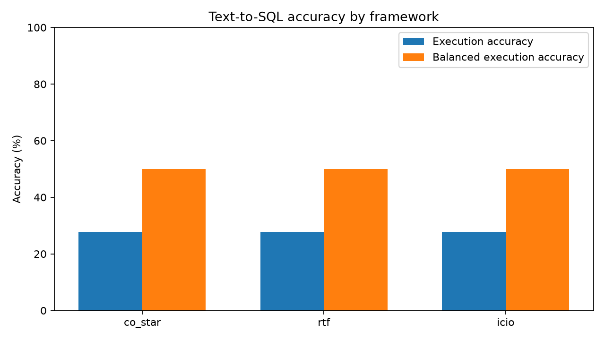
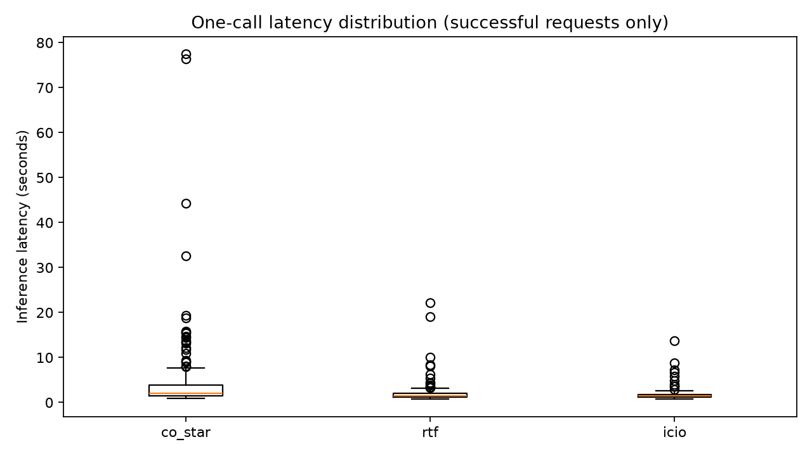

# Week 03 — Prompt comparison (generated report)

**Protocol:** 155 independent questions are sent to each prompt, one stateless call per question. Execution accuracy compares the multisets of result rows; row ordering is ignored.

## Task 2 — Execution accuracy and latency

| Framework | Correct / Total | Accuracy | Valid SQL | Mean latency (s) | Median latency (s) |
|---|---:|---:|---:|---:|---:|
| co_star | 43 / 155 | 27.74% | 100.00% | 5.055 | 2.099 |
| rtf | 43 / 155 | 27.74% | 100.00% | 2.095 | 1.452 |
| icio | 43 / 155 | 27.74% | 100.00% | 1.758 | 1.407 |

## Task 3 — Additional metric: balanced execution accuracy

The published accuracy is the fraction of questions with exactly correct executed result rows. Empty answers account for 43/155 questions. A generator could get those cases right by returning empty results without understanding the SQL request.

**Balanced execution accuracy** is the average of (a) execution accuracy on questions whose gold result is empty and (b) execution accuracy on questions whose gold result is non-empty. Each group receives 50% weight regardless of its size. It complements — rather than replaces — ordinary execution accuracy.

| Framework | Non-empty group | Empty group | Balanced accuracy |
|---|---:|---:|---:|
| co_star | 0.00% | 100.00% | 50.00% |
| rtf | 0.00% | 100.00% | 50.00% |
| icio | 0.00% | 100.00% | 50.00% |

## Task 4 — Paired significance tests

Cochran's Q (three matched frameworks): Q = 0.0000, df = 2, asymptotic p = 1.

Pairwise exact two-sided McNemar tests, with Holm correction for three simultaneous comparisons:

| Comparison | Left-only correct | Right-only correct | Raw p | Holm p |
|---|---:|---:|---:|---:|
| co_star vs rtf | 0 | 0 | 1 | 1 |
| co_star vs icio | 0 | 0 | 1 | 1 |
| rtf vs icio | 0 | 0 | 1 | 1 |

**Interpretation guidance:** p < 0.05 after Holm correction gives evidence of different *execution accuracy* on these paired questions; it does not prove that a framework is universally better. Cochran's Q is an omnibus test with a chi-square approximation. Replicate with multiple seeds/model runs for a stronger conclusion about stochastic variation.

**Limitations:** This is one dataset and one run per prompt. API/network latency contributes to measured inference times. Frameworks use identical schema, few-shot examples, model parameters, and questions where possible. Inspect invalid SQL and extreme cases manually. Do not use gold results to generate predictions. Document model, date, settings, and coding agent.

## Manual discussion to complete before submission

Explain the observed trade-offs, typical SQL failures, distracting clauses, and how CO-STAR (rich structure), RTF (minimal structure), and ICIO (explicit input boundary) may have influenced the results. Record the exact model and any agent used to write or run the code.
