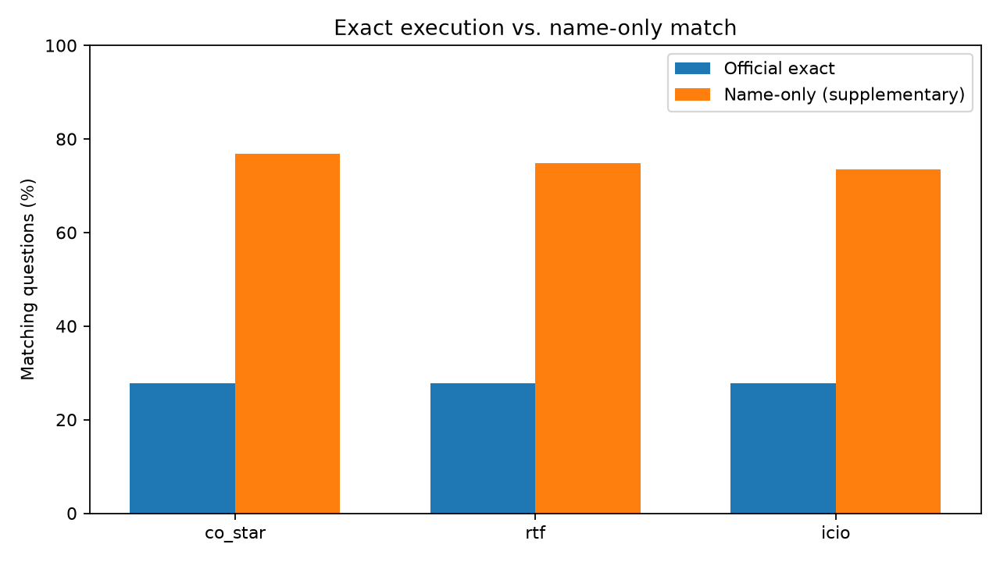

# Supplementary analysis: inconsistent restaurant IDs

The official execution evaluator compares complete `(ID, NAME)` result-row multisets.
Its result is preserved without modification. The supplementary name-only metric
compares multisets of `NAME` values, ignoring the first (ID) column. It requires
two output columns. This helps diagnose changed or inconsistent IDs but cannot
distinguish restaurants sharing a name. Empty results count as exact name matches.

## Reference-data integrity audit

- Database restaurant rows: 9589
- Expected output rows: 13235
- Existing expected `(ID, NAME)` pairs: 3/13235
- Expected names present in database: 13235/13235
- Expected rows with a name duplicated in the database: 4017/13235
- Questions whose expected result is empty: 43/155

**Interpretation:** Incorrect reference IDs constrain the achievable official score
for ordinary queries returning true database IDs. Do not change IDs or gold labels
and do not hard-code expected outputs into generated SQL.

## Results

| Framework | Official exact | Name-only | Name nonempty | Name empty | Balanced name-only |
|---|---:|---:|---:|---:|---:|
| co_star | 27.74% | 76.77% | 67.86% | 100.00% | 83.93% |
| rtf | 27.74% | 74.84% | 65.18% | 100.00% | 82.59% |
| icio | 27.74% | 73.55% | 63.39% | 100.00% | 81.70% |

## Paired statistical significance

The same questions are used for all three frameworks. Cochran's Q is
the omnibus paired test; exact two-sided McNemar tests compare pairs,
with Holm adjustment within each family of three pairwise comparisons.

- official: Cochran Q=0.0000, approximate p=1
- name_only: Cochran Q=2.5333, approximate p=0.281769

| Metric | Comparison | Left-only | Right-only | Raw p | Holm p |
|---|---|---:|---:|---:|---:|
| official | co_star vs rtf | 0 | 0 | 1 | 1 |
| official | co_star vs icio | 0 | 0 | 1 | 1 |
| official | rtf vs icio | 0 | 0 | 1 | 1 |
| name_only | co_star vs rtf | 5 | 2 | 0.453125 | 0.90625 |
| name_only | co_star vs icio | 8 | 3 | 0.226562 | 0.679688 |
| name_only | rtf vs icio | 7 | 5 | 0.774414 | 0.90625 |

## Limitations

Name equality does not prove correct restaurant identity when names repeat.
The supplementary metric is therefore a diagnostic, not a replacement
for the official scorer. The ID-label mismatch should be reported to
the instructor. A single run per prompt does not establish stability
across sampling seeds. Execution is protected by a timeout and row cap
and may differ from the unrestricted official evaluator.
