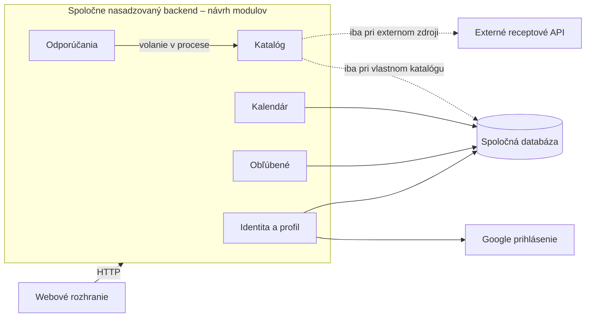

# ADR-001: Modulárny monolit pre RecipeCove

| Údaj | Hodnota |
| --- | --- |
| Dátum rozhodnutia | 2026-10-29 |
| Verzia dokumentu | 0.1 – prvý pracovný návrh |
| Stav architektonickej voľby | Modulárny monolit vybraný používateľom v Task 1, E006 |
| Stav dokumentu | Návrh na kritické hodnotenie; používateľom zatiaľ neschválený |
| Rozsah | Architektúra aplikácie; bez výberu konkrétneho technologického stacku |

## 1. Kontext a požiadavky

RecipeCove je webová aplikácia na objavovanie receptov, prezeranie údajov o receptoch a ingredienciách a osobné plánovanie varenia. Rozhodnutie vychádza z [pôvodných požiadaviek](../../Tasks/data/RecipeCove.txt) a [diskusie Task 1](task1_discussion.md), nie z meraní existujúcej implementácie.

| Potvrdená funkčná oblasť | Zdroj v RecipeCove.txt |
| --- | --- |
| Registrácia cez Google, prihlásenie, odhlásenie a osobný profil | Príbehy 1, 6–8 |
| Vyhľadávanie receptu podľa názvu, detail receptu a ingrediencie | Príbehy 2–4 |
| Odporúčania receptov podľa diéty prostredníctvom chatbota | Opis systému a príbeh 5 |
| Vytvorenie a zmazanie osobného kalendára, pridanie udalosti viazanej na recept | Príbehy 9–11 |
| Pridanie, odstránenie a zobrazenie obľúbených receptov | Príbehy 12–14 |

Používateľ počas diskusie doplnil tieto preferencie:

- Zdroj receptov zostáva otvorený: vlastný katalóg alebo externé API. Nevyžaduje sa implementovať oba súčasne (E002).
- Uložený recept môže neskôr prestať byť dostupný. Aplikácia má tento stav vysvetliť; prípadné uchovanie názvu alebo iných základných údajov závisí od podmienok zdroja. Úplná kópia obsahu sa nevyžaduje (E004).
- Po potvrdenom zápise do obľúbených alebo kalendára má používateľ pri ďalšom načítaní vidieť vlastnú zmenu. Neskoršia súbežná zmena môže stav oprávnene zmeniť. Pri vyhľadávacom indexe je krátke oneskorenie prijateľnejšie, bez určeného časového limitu (E005).

**Neznáme údaje a predpoklady:** Nie sú určené záťaž, rozpočet, kapacita tímu ani ciele dostupnosti a odozvy. Neodvodzujeme z toho malý systém ani nízke prevádzkové náklady. Nie je prijatý predpoklad konkrétneho cloudu, databázy či LLM. Rozsah pripomienok a spôsob odporúčania zostávajú otvorené.

## 2. Kritériá rozhodnutia

Používateľ v E006 uprednostnil jednoduchosť implementácie, spoločného nasadzovania a práce so súvisiacimi údajmi, pretože ich prínos je relevantný už pre súčasné požiadavky. Ďalšími kritériami sú viditeľnosť vlastných zápisov, izolácia porúch, riadenie kapacity a prevádzková zložitosť.

Potreba nezávislého škálovania alebo vydávania funkčných oblastí zatiaľ nebola doložená. Kritériám neboli pridelené číselné váhy a alternatívy nemajú zmerané výkonnostné ani cenové poradie.

## 3. Rozhodnutie a rozsah

### Prijaté používateľom

RecipeCove bude navrhnuté ako **modulárny monolit**: backend so zreteľnými vnútornými hranicami, nasadzovaný spoločne. Prijatými nevýhodami sú spoločné vydávanie a zdieľané zdroje. Ich vplyv sa má monitorovať a prednostne riešiť v rámci monolitu. Dôkaz potreby nezávislého škálovania alebo lepšej izolácie môže viesť k prehodnoteniu, nie k automatickej migrácii (E006).

### Navrhované detaily na posúdenie

Nasledujúce rozdelenie konkretizuje variant A z E002; výber architektúry neznamená samostatné schválenie každého detailu:

- Moduly **Identita a profil**, **Katalóg**, **Odporúčania**, **Obľúbené** a **Kalendár** komunikujú cez definované rozhrania v jednom procese backendu.
- Web volá backend cez HTTP. Backend integruje Google prihlásenie; presný mechanizmus relácií a odhlásenia sa ešte určí.
- Spoločná databáza uchováva lokálne údaje. Tabuľky majú určený spravujúci modul; iné moduly neobchádzajú jeho pravidlá priamymi zápismi. Spoločné transakcie sú možné pri vhodnom úložisku a koordinácii cez modulové rozhrania.
- Katalóg sprostredkuje lokálne recepty alebo externé API podľa budúceho rozhodnutia. Pri externom zdroji sa lokálne ukladajú osobné väzby; uchovanie receptových metadát je stále otvorené.
- Úspech osobného zápisu sa potvrdí až po commite. Následné čítanie musí rešpektovať požadovanú viditeľnosť zápisu; zastaraná cache alebo oneskorená replika ju nesmie potichu porušiť.

Diagram zobrazuje navrhované komponenty a hlavné závislosti, nie úplný tok všetkých požiadaviek. Prerušované väzby sú otvorené varianty pôvodu dát, nie rozhodnutie využívať oba. Jedno spoločné nasadenie nevylučuje viac replík celého backendu. Konkrétne úložisko a hosting nie sú diagramom vybrané.

## 4. Zvažované alternatívy

**A – modulárny monolit:** Moduly komunikujú v procese a využívajú spoločnú databázu. **B – samostatné služby:** Účet/profil, katalóg, odporúčania a osobné zbierky majú vlastné nasadenia, sieťové API a vlastníctvo dát; obľúbené a kalendár sú v jednej službe. **C – serverless s udalosťami:** Funkcie spúšťané požiadavkami a udalosťami využívajú spravované úložisko a asynchrónne spracovanie odvodených údajov.

Porovnanie C vychádza aj z úpravy v E005: obľúbené a kalendár čítajú priamo autoritatívny stav. Oneskorené osobné pohľady z pôvodného E004 teda nie sú nutnou súčasťou upraveného C. B a C sú distribuované a môžu sa prekrývať; líšia sa tu modelom vykonávania a použitím udalostí.

| Kritérium | A: modulárny monolit | B: samostatné služby | C: upravený serverless |
| --- | --- | --- | --- |
| Implementácia a nasadenie | Lokálne volania, spoločné vydanie; treba udržať modulárne hranice | Nezávislé vydania; verzie API, sieťové chyby a viac prevádzkových jednotiek | Platforma spravuje spúšťanie; limity funkcií, udalosti a väzba na platformu |
| Súvisiace údaje a transakcie | Spoločná databáza uľahčuje transakcie naprieč modulmi | Lokálne transakcie v službe; medzi vlastníkmi dát bez spoločného cudzieho kľúča | Garancie určuje úložisko, nie funkcie; udalosti vyžadujú spoľahlivé zachytenie a opakovateľné spracovanie |
| Viditeľnosť osobného zápisu | Commit a konzistentné čítanie, pozor na cache/repliky | Rovnaká možnosť v službe osobných zbierok | Priame konzistentné čítanie; osobné projekcie netreba |
| Kapacita a poruchy | Zdieľané zdroje; vnútorné limity pomáhajú, proces zostáva spoločný | Oddelená kapacita a lepšia izolácia; spoločné závislosti ju môžu obmedziť | Kapacitu funkcií riadi platforma; súbeh môže vyčerpať úložisko alebo API, front izoluje iba asynchrónnu časť |
| Zdroj receptov | Vlastný katalóg alebo API cez modul | Obe možnosti cez službu katalógu | Obe možnosti cez funkcie; externé aktualizačné udalosti nemožno predpokladať |
| Cena a prevádzkové dôkazy | Bez záťaže a hostingu neurčené | Bez záťaže a infraštruktúry neurčené | Bez počtu spustení, správ a operácií úložiska neurčené |

**Dôvod výberu A:** Jeho prínosy zodpovedajú používateľovým aktuálnym prioritám. Prínos nezávislosti B a spravovaného spúšťania C zatiaľ neodôvodňuje ich dodatočnú zložitosť. Neznamená to, že B alebo C nedokážu splniť požiadavky, ani že A je univerzálne najlacnejšia možnosť. Externé API samo osebe nevyžaduje distribuované riešenie.

## 5. Dôsledky, riziká a navrhované mitigácie

Lokálne volania a spoločné úložisko znižujú potrebu sieťovej koordinácie. Spoločné nasadenie však spája vydávanie modulov a spoločné zdroje obmedzujú izoláciu. Nasledujúce opatrenia sú návrhy z diskusie alebo ich konkretizácia pre budúcu implementáciu; neboli implementované ani overené.

| Riziko alebo problém | Navrhované opatrenie | Limit opatrenia |
| --- | --- | --- |
| Pomalé API alebo náročné odporúčania spotrebujú kapacitu | Asynchrónne I/O tam, kde sa čaká na sieť; timeouty, limity súbehu a oddelené fondy spojení | Pomalé volanie automaticky nezablokuje backend; asynchrónne I/O však nerieši náročný výpočet ani všetky spoločné zdroje (E003) |
| Súbežné pridanie rovnakého obľúbeného receptu | Jedinečnosť dvojice používateľ–recept v databáze | Kontrola existencie v aplikačnom kóde sama nestačí |
| Súbeh zmazania kalendára a pridania udalosti | Overenie vlastníctva, transakcia a referenčná integrita | Treba určiť izoláciu a správanie pri konflikte; spoločná databáza nestačí bez správnej implementácie |
| Neistý výsledok zápisu po strate odpovede | Pre vytváranie udalostí zvážiť identifikátor operácie uložený atómovo s výsledkom | Timeout nedokazuje neúspešný zápis; slepé opakovanie môže vytvoriť duplicitu aj v monolite |
| Zmiznutý alebo dočasne nedostupný externý recept | Rozlíšiť dočasnú chybu od odstránenia, vysvetliť nedostupnosť; metadáta iba podľa podmienok zdroja | Lokálna transakcia nezaručí existenciu externého obsahu; používateľ akceptuje jeho možnú stratu |
| Postupné porušovanie hraníc modulov | Definované rozhrania a kontrola závislostí pri revízii kódu | Spoločný proces a databáza hranice samy nevynucujú |

Externé volania nemajú zbytočne držať otvorené databázové transakcie. Opakovanie vybraných dočasných chýb musí mať limity, inak môže preťaženie zhoršiť. Tieto opatrenia nezaručujú úplnú izoláciu porúch.

## 6. Budúce overenie a prehodnotenie

Nasledujúce scenáre sú **návrh budúceho overenia**, nie vykonané testy alebo dohodnuté akceptačné prahy:

- Uložiť obľúbený recept a kalendárovú udalosť, obnoviť stránku a overiť viditeľnosť potvrdeného zápisu aj pri zapnutej cache alebo replikách.
- Súbežne pridať rovnaký obľúbený recept a súbežne zmazať kalendár s pridávaním udalosti; overiť neduplicitnosť a neprítomnosť osirelých udalostí podľa zvolených pravidiel.
- Simulovať pomalé alebo nedostupné receptové API a záťaž odporúčaní; sledovať odozvu a chybovosť profilu a kalendára, čas čakania, počet aktívnych spojení, pamäť a CPU.
- Stratiť odpoveď po úspešnom zápise a zopakovať požiadavku; overiť správanie proti duplicitám. Skontrolovať zobrazenie dočasne nedostupného aj odstráneného receptu.
- Overiť, že používateľ nemôže meniť cudzie obľúbené ani kalendáre; ide o navrhovanú kontrolu správania osobných údajov, nie nový výsledok testu.

Ciele odozvy, prípustná chybovosť, veľkosť záťaže a limity zdrojov sa musia ešte dohodnúť. Monitoring má ukázať, či konkrétna oblasť dlhodobo poškodzuje ostatné a či vnútorné opatrenia postačujú. Preukázaná potreba nezávislej kapacity alebo izolácie je dôvodom znovu posúdiť hranice nasadenia. Nejde o vopred schválené vyčlenenie služby.

## 7. Otvorené otázky

- Vlastný katalóg alebo externé API: pôvod, aktualizácie, identita receptu a prípustné uchovanie metadát.
- Chatbot: spôsob výberu receptov, reprezentácia diéty a kontrola odporúčaní; LLM nie je rozhodnuté.
- Kalendár: či pripomienka znamená iba udalosť alebo aj aktívne upozornenie, jeho kanál a plánovanie. Google prihlásenie neznamená Google Calendar.
- Konkrétna databáza, transakčné a čítacie garancie, implementačný stack, hosting a relácie vrátane odhlásenia.
- Očakávaná záťaž, tím, rozpočet, dostupnosť a ciele odozvy potrebné na prevádzkové overenie rozhodnutia.

## 8. Zdroje a história dokumentu

- [RecipeCove.txt](../../Tasks/data/RecipeCove.txt): pôvodné požiadavky.
- [Task 1 – diskusia](task1_discussion.md): E002 návrh A a otvorený pôvod dát; E003 návrh B a korekcia rizika pomalých volaní; E004 návrh C a nedostupné recepty; E005 úprava C a viditeľnosť vlastných zmien; E006 používateľov výber a prijaté nevýhody.
- [Oficiálne zadanie Task 2](../../Tasks/Task_2.md) a [záznam práce na Task 2](task2_discussion.md).

Verzia 0.1 bola vytvorená ako prvý návrh na základe aktuálnej diskusie. Neobsahuje používateľské pripomienky k ADR ani vykonané revízie, pretože ešte nenastali. Architektonická voľba bola prijatá v Task 1; prijatie tohto dokumentu čaká na skutočné hodnotenie používateľom.
