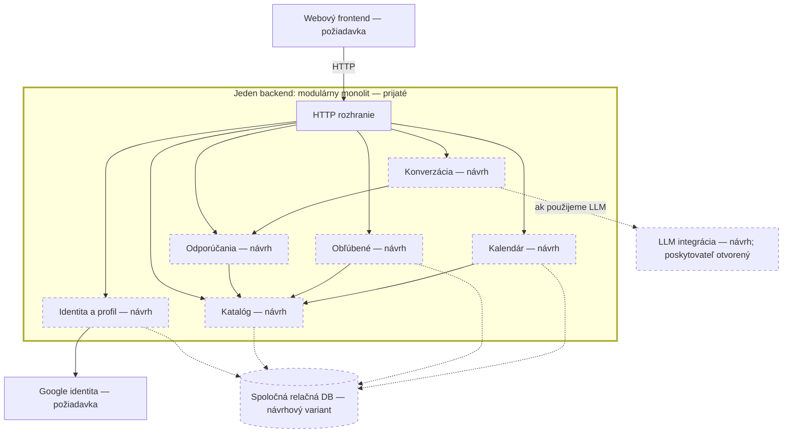

# ADR-001: Modulárny monolit pre RecipeCove

| Údaj | Hodnota |
|---|---|
| Verzia dokumentu | 1.0 |
| Stav dokumentu | Accepted |
| Stav architektonického rozhodnutia | Modulárny monolit zvolený študentom na konci Task 1 |
| Dátum | 2026-10-29 |
| Rozsah | Architektúra backendu RecipeCove; bez výberu konkrétnych technológií |

## 1. Kontext

RecipeCove je webová aplikácia na objavovanie receptov, prezeranie informácií o receptoch a ingredienciách a organizáciu osobných kuchárskych plánov. Potrebujeme zvoliť architektúru, ktorá podporí tieto funkcie a pritom nezavedie zložitosť bez opory v známych požiadavkách.

### Potvrdené funkčné požiadavky

Podľa [opisu RecipeCove](../../Tasks/data/RecipeCove.txt):

| Oblasť | Požadované správanie | User stories |
|---|---|---|
| Objavovanie receptov | Návštevník vyhľadáva podľa názvu a prezerá detaily receptov a ingrediencií | 2–4 |
| Odporúčania | Návštevník dostane odporúčania podľa konkrétnej diéty; opis systému uvádza chatbota | 5 a opis systému |
| Identita a profil | Registrácia cez Google účet, prihlásenie, odhlásenie a zobrazenie osobného profilu | 1, 6–8 |
| Kalendár | Registrovaný používateľ vytvorí alebo vymaže kalendár a pridá udalosť pripomínajúcu prípravu receptu v určitý deň | 9–11 |
| Obľúbené | Registrovaný používateľ pridáva a odoberá recepty a prezerá svoj zoznam | 12–14 |

Spôsob doručovania pripomienok nie je určený. Google prihlásenie neznamená požiadavku na Google Calendar. Používateľské vytváranie receptov sa v zadaní neuvádza.

### Pracovné predpoklady a chýbajúce informácie

- **Pracovný predpoklad z diskusie:** chatbot umožní vyjadriť stravovacie preferencie prirodzeným jazykom. Presné konverzačné schopnosti nie sú potvrdenou požiadavkou. Jednoduchší filter podľa diéty zostáva preskúmanou alternatívou rozhrania.
- **Podmienka rozhodnutia:** nemáme potvrdené mimoriadne vysoké zaťaženie, nezávislé vývojové tímy ani osobitné prevádzkové obmedzenia. Neznamená to, že sme potvrdili malý počet používateľov alebo konkrétnu veľkosť tímu.
- Nevieme počet používateľov, objem dát, požadovanú odozvu, dostupnosť, rozpočet ani priebeh záťaže. Porovnanie výkonu a nákladov je kvalitatívne; nemáme benchmarky ani cenový výpočet.
- Zdroj a aktualizácia receptov a ingrediencií zostávajú otvorené. Výber monolitu sám neurčuje, či bude katalóg lokálny alebo externý.

## 2. Rozhodovacie kritériá

V aktuálnom rozhodnutí uprednostňujeme primeranú implementačnú a prevádzkovú zložitosť, predvídateľnosť pravidiel a jednoduchú integritu súvisiacich dát. Obľúbené a kalendár už vyplývajú zo zadania; potreba nezávislého nasadzovania a škálovania zatiaľ potvrdená nie je. Preto teraz akceptujeme spoločné nasadzovanie a zdroje namiesto zavedenia distribuovanej komunikácie a dátových hraníc.

Ochrana pred pomalým LLM a možnosť reagovať na rast zostávajú dôležité. Hodnotenie všetkých alternatív podľa rovnakých kritérií uvádza oddiel 4; ide o kvalitatívne zdôvodnenie bez skóre, číselných váh a benchmarkov.

## 3. Rozhodnutie

**Pre aktuálne RecipeCove volíme modulárny monolit.** Backend bude nasadzovaný ako jeden celok, vnútorne rozdelený podľa funkčných zodpovedností. Moduly budú spolupracovať cez definované interné rozhrania, bez potreby samostatnej sieťovej služby pre každú oblasť. Frontend bude komunikovať s backendom cez HTTP.

Rozhodnutie neobmedzuje systém na jednu bežiacu inštanciu. Pri replikovaní však treba riešiť relácie, kontext rozhovoru a koordináciu spoločných limitov.

### Čo je rozhodnuté, navrhnuté a otvorené

| Stav | Obsah |
|---|---|
| **Prijaté v Task 1** | Modulárny monolit, spoločné nasadzovanie backendu a komunikácia modulov cez interné rozhrania. Pre konverzačný variant oddelenie LLM interpretácie od overovania kritérií a výberu receptov backendom. |
| **Návrhový variant** | Konkrétne moduly uvedené nižšie, spoločná relačná DB a napojenie LLM cez modul Konverzácia. Konverzácia prirodzeným jazykom je pracovný predpoklad; jednoduchý filter zostáva alternatívou. |
| **Otvorené** | Finálne hranice modulov, databázový produkt a schéma, lokálny či externý katalóg, jazyk/framework, hosting, konkrétny LLM a jeho poskytovateľ. Ďalšie otázky sú v oddiele 7. |

### Vizuálny náčrt

**Plný rámček backendu označuje prijatú hranicu nasadzovania.** Frontend a Google identita vyplývajú zo zadania. Rámčeky s označením „návrh“ a prerušovaným okrajom sú návrhové detaily; LLM integrácia je podmienená konverzačným variantom. Šípky medzi modulmi znamenajú interné volania, nie sieťové služby.

Diagram zobrazuje diskutovaný variant s lokálnym katalógom v spoločnej DB. Neuzatvára otázku pôvodu receptov ani ich aktualizácie; externý zdroj by bol dostupný cez adaptér Katalógu. Neurčuje uloženie kontextu rozhovoru ani konkrétne produkty.

### Náčrt modulov na ďalšie spresnenie

Zodpovednosti modulov z diagramu:

| Modul | Zodpovednosť |
|---|---|
| Identita a profil | Google prihlásenie/registrácia, relácia, odhlásenie, profil |
| Katalóg | Prístup k receptom a ingredienciám, detaily a vyhľadávanie podľa názvu |
| Odporúčania | Overenie podporovaných kritérií a deterministický výber vhodných receptov |
| Konverzácia | Kontext rozhovoru, interpretácia cez LLM a príprava odpovede pri konverzačnom variante |
| Obľúbené | Používateľské zoznamy a pridávanie/odoberanie receptov |
| Kalendár | Kalendáre a udalosti odkazujúce na recept a deň |

Spoločná relačná DB umožňuje transakcie a cudzie kľúče medzi lokálnymi dátami. Pri externom katalógu však lokálna transakcia nezaručí jeho dostupnosť ani nemennosť. Spoločné úložisko nesmie viesť k obchádzaniu rozhraní a pravidiel modulov.

### Dohodnutá zodpovednosť pri konverzačnom variante

LLM prevádza prirodzený jazyk na štruktúrované kritériá a môže pomôcť formulovať odpoveď. Backend kritériá overuje a vyberá recepty z katalógu. Prípadné zoradenie pomocou LLM smie pracovať iba s už vyfiltrovanými receptmi a musí byť overené; nie je povinnou funkciou.

Po návrate z LLM Konverzácia odovzdá kritériá Odporúčaniam, ktoré ich overia a použijú Katalóg. Jednoduchý filter môže využívať rovnaké Odporúčania bez LLM.

## 4. Zvažované alternatívy a zdôvodnenie voľby

| Kritérium | Modulárny monolit — zvolený | Mikroslužby s vlastnými dátami | Serverless funkcie so spoločnou relačnou DB |
|---|---|---|---|
| Implementačná a prevádzková jednoduchosť | Interné volania a jeden nasadzovaný backend znižujú réžiu | Sieťové API, kompatibilita vydaní a viac prevádzkových častí | Platforma spravuje vykonávanie, ale pribúda konfigurácia, stav mimo inštancií, studené štarty a časové limity |
| Predvídateľné, testovateľné odporúčania | LLM a pravidlá výberu možno oddeliť modulmi | Rovnaké oddelenie je možné; navyše treba overovať komunikáciu služieb | Rovnaké oddelenie je možné cez spoločnú knižnicu; treba strážiť jej verzie |
| Konzistencia súvisiacich dát | V spoločnej relačnej DB jednoduchšie transakcie a cudzie kľúče | Lokálne transakcie v službe; referencie medzi službami vyžadujú ďalšie pravidlá | Spoločná relačná DB umožňuje rovnaké transakčné záruky ako diskutovaný monolit |
| Ochrana zdrojov a izolácia porúch | Spoločný proces; nutné limity a súbežné spracovanie | Lepšia možnosť izolácie procesov; závislé služby a spoločná infraštruktúra zostávajú rizikom | Oddelené vykonania; násobenie funkcií môže vyčerpať DB alebo LLM, potrebná koordinácia limitov |
| Nezávislé nasadzovanie a škálovanie | Spoločné vydanie, replikovanie backendu ako celku | Priamy prínos samostatných služieb; zatiaľ nie je potvrdená potreba | Platforma škáluje vykonania v rámci limitov; dátová schéma a knižnice stále vytvárajú väzby |

**Prečo kritériá vedú k monolitu:** nezávislé služby by zaviedli sieťové a dátové problémy už teraz, kým potrebu ich nezávislosti nepoznáme. Jednoduchosť implementácie a lokálnej integrity sa naopak týka už požadovaných funkcií. Serverless variant môže zachovať rovnakú konzistenciu dát, takže konzistencia ho sama nevylučuje; zatiaľ však nemáme údaje o nepravidelnej záťaži alebo nákladoch, ktoré by odôvodnili jeho platformové kompromisy. Oddelenie LLM od pravidiel je uskutočniteľné vo všetkých troch návrhoch a samo o sebe nerozhoduje medzi nimi.

Porovnávame konkrétne návrhy, nie vzájomne výlučné kategórie: serverless možno kombinovať aj s mikroslužbami. V našom serverless variante funkcie používali spoločnú DB a mohli zdieľať knižnicu pravidiel; mikroslužbový variant mal dátové vlastníctvo služieb a sieťové volanie Receptov z Konverzácie.

Všetky návrhy môžu splniť funkčný rozsah. Náklady zahŕňajú aj správu a riešenie incidentov; bez meraní netvrdíme, že monolit je vždy najlacnejší alebo najrýchlejší.

## 5. Dôsledky a akceptované kompromisy

Prínosy podľa oddielu 4 získavame za cenu nasledujúcich rizík a opatrení:

| Akceptované riziko | Opatrenie a jeho hranica |
|---|---|
| Spoločné vydanie backendu a replikovanie celku | Jasné hranice modulov; samostatné vydávanie modulov tým nezískame |
| Chat môže spotrebovať zdroje ostatných funkcií | Súbežné spracovanie pomocou neblokujúceho I/O alebo pracovníkov, timeouty a obmedzenie LLM volaní; nejde o úplnú izoláciu |
| Vyčerpanie DB poolu | Spojenia a transakcie používať iba počas potrebných DB operácií, nie počas čakania na LLM |
| Prekročenie LLM kvót pri viacerých procesoch | Koordinovať súbežnosť, počet požiadaviek a tokeny; lokálny semafor nechráni celú aplikáciu |
| Rozpad modularity pri spoločnom kóde a DB | Používať rozhrania modulov a neobchádzať pravidlá výberu receptov |

Presné limity ani implementácia týchto opatrení nie sú vybrané. Čísla z Pythonového príkladu v Task 1 nepredstavujú prevádzkové požiadavky. Opatrenia treba overiť meraniami; výsledky implementácie ani testovania zatiaľ neexistujú.

Pri skúmaní mikroslužieb študent výslovne zvolil odmietnutie pridania obľúbeného receptu, ak nemožno overiť jeho existenciu cez nedostupnú službu Recepty. Akceptoval nižšiu dostupnosť výmenou za absenciu čakajúcich zápisov. Toto čiastkové rozhodnutie nevytvára v monolite službu Recepty; konkrétne správanie pri nedostupnom lokálnom alebo externom katalógu treba spresniť. Ani úspešné overenie nezaručí budúcu dostupnosť receptu.

## 6. Budúce overovanie a podmienky prehodnotenia

Nasleduje **návrh budúceho overovania**, nie vykonané testy ani nové prevádzkové požiadavky. V rovnakom prostredí a pri porovnateľnej záťaži najprv zmeriame správanie bez problémov LLM a potom s riadeným spomalením alebo výpadkom. Oddelíme čas externého volania od čakania na interné zdroje.

| Scenár | Čo sledovať |
|---|---|
| Pomalé LLM pri súbežnom vyhľadávaní, pridaní obľúbeného receptu a práci s kalendárom | Rozdelenie časov odozvy a chybovosť každej funkcie, obsadenosť a čas čakania na DB spojenia, využitie pracovníkov, CPU a pamäte |
| Výpadky LLM a naplnenie kapacity chatu | Počet timeoutov a odmietnutí, počet rozpracovaných a čakajúcich požiadaviek, zotavenie po obnovení LLM a vplyv na ostatné funkcie |
| Rast záťaže a prípadné replikovanie backendu | Priepustnosť, odozva a saturácia zdrojov; celkové LLM volania a tokeny za obdobie naprieč procesmi vo vzťahu k skutočným kvótam |
| Súbežné pridávanie rovnakého obľúbeného receptu a zlyhanie počas mazania kalendára | Duplicity väzieb a čiastočne vykonané zmeny oproti navrhnutým pravidlám integrity a transakciám, ak sa spoločná relačná DB potvrdí |

Prijateľné odozvy, chybovosť a kapacitu ešte treba dohodnúť podľa reálnej potreby. Samotné namerané zhoršenie preto nie je automatickým dôvodom migrácie. Najprv určíme príčinu a vyhodnotíme jednoduchšie opatrenia v monolite; ich účinok porovnáme rovnakými meraniami.

Rozhodnutie prehodnotíme, ak nové požiadavky alebo merania preukážu potrebu nezávislého škálovania, izolácie či nasadzovania, ktorú nemožno primerane riešiť v monolite.

Najsilnejším signálom podľa študenta sú namerané problémy so zdrojmi. Ak Konverzácia aj po primeraných opatreniach poškodzuje ostatné funkcie, možno zvážiť jej vyčlenenie do služby. Nejde o záväzný migračný plán; extrakcia sama neodstráni kvóty externého LLM.

## 7. Otvorené otázky a rozsah ďalších rozhodnutí

- Odkiaľ získame recepty a ingrediencie, ako ich aktualizujeme a čo zobrazíme pri nedostupnom alebo odstránenom recepte?
- Ktoré diéty a kritériá podporujeme a ako vyhodnotíme neúplné údaje?
- Aký rozsah konverzácie je potrebný? Ako budeme spravovať kontext návštevníka a aké údaje prípadne pošleme LLM poskytovateľovi?
- Ako sa doručujú pripomienky a koľko kalendárov môže používateľ mať?
- Aká záťaž, odozva, dostupnosť, rozpočet a prevádzkové prostredie sa očakávajú?
- Potvrdíme spoločnú relačnú DB a navrhnuté moduly? Aký jazyk, framework a prípadný LLM použijeme?
- Aké konkrétne timeouty, limity a merania použijeme na overenie ochrany spoločných zdrojov?

Konkrétne produkty, počet inštancií ani číselné SLA týmto ADR neurčujeme.

## 8. Podklady

- [Požiadavky RecipeCove](../../Tasks/data/RecipeCove.txt) — funkčný rozsah.
- [Diskusia Task 1](task1_discussion.md) — tri návrhy, odpovede študenta a oddiel „Uzavretie Task 1 — finálne rozhodnutie študenta a kontrola záznamu“. Doplnkové poznámky asistenta označené v kontrole nepovažujeme za prijaté rozhodnutia.
- [Zadanie Task 2](../../Tasks/Task_2.md) a [záznam jeho diskusie](task2_discussion.md) — príprava a budúce pripomienkovanie dokumentu.
- [Verzia 0.1](ADR_v0.1.md) a [verzia 0.2](ADR_v0.2.md) — zachované predchádzajúce pracovné verzie na porovnanie.
