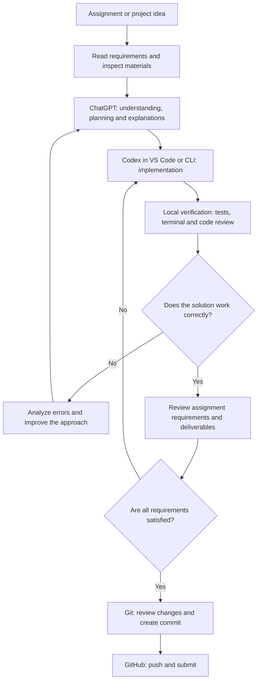

# Task 10 – My Personal AI Workflow

## 1. Overview

As a computer science student, I use LLM-based tools for studying, software development, problem-solving, and understanding unfamiliar technologies.

My workflow primarily combines **ChatGPT, OpenAI Codex, Visual Studio Code, the terminal, and Git/GitHub**.

I use different tools for different purposes rather than relying on a single AI assistant for everything.

## 2. My Typical Workflow

### Understanding and planning

I usually begin by reading the assignment requirements and examining the available materials.

I use ChatGPT to clarify unfamiliar concepts, break complex assignments into manageable steps, discuss possible approaches, and identify potential difficulties.

I prefer understanding why a particular solution works instead of simply generating code.

### Implementation

For programming tasks, I primarily use OpenAI Codex integrated into Visual Studio Code or its command-line interface.

Codex helps me explore repositories, understand existing code, implement functionality, generate tests, and prepare documentation.

I provide instructions describing the desired outcome and relevant constraints. For more complicated tasks, I work iteratively rather than requesting the entire implementation at once.

### Testing and verification

I do not consider AI-generated output correct merely because the assistant reports success.

I inspect relevant changes and run appropriate tests or commands to verify the results.

When something fails, I investigate the error, sometimes consult ChatGPT for another explanation or perspective, and return to the implementation.

This creates an iterative cycle of implementation, testing, feedback, and correction.

### Version control and submission

I use Git to track changes and GitHub to store and submit projects.

Before committing, I check the repository status, review the deliverables, and verify that unnecessary files or sensitive information are not included.

For coursework, I also compare the completed work against the original assignment requirements.

## 3. Additional AI Capabilities

I have experimented with reusable skills, custom instructions, MCP tools, and subagents.

These features can make workflows more structured and extend an assistant's capabilities.

However, spawning subagents is not currently a routine part of my development process. I have mainly explored it as part of learning how coding assistants work.

## 4. Workflow Diagram

The following diagram illustrates my typical software development workflow and its validation loops.

## 5. Reflection

The main advantage of this workflow is the separation between understanding, implementation, and verification.

ChatGPT helps me reason about problems and learn unfamiliar concepts, while Codex assists with practical development tasks.

However, LLM outputs can contain mistakes or misunderstand requirements. Therefore, I treat their suggestions as work that needs verification rather than automatically accepting them as correct.

My goal is to use AI to improve productivity and learning while maintaining responsibility for the final solution.